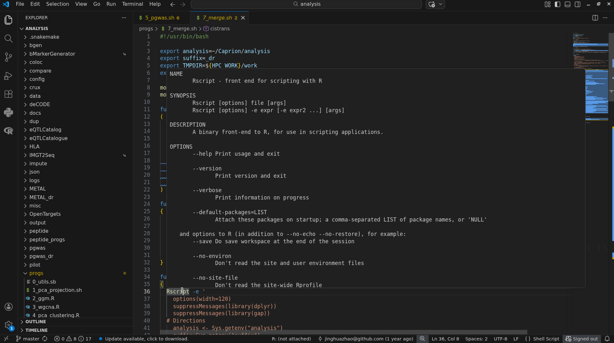

# Visual Studio code

Web: <https://code.visualstudio.com/>.

| Date | Module |
|---|---|
| 3/11/2026 | `ceuadmin/VSCode/1.144.1`  |
| 19/8/2026 | `ceuadmin/VSCode/1.133.0`  |
| 23/5/2026 | `ceuadmin/VSCode/1.121.0`  |
| 13/9/2025 | `ceuadmin/VSCode/1.104.0`  |
| 18/5/2025 | `ceuadmin/VSCode/1.100.2`  |

## Installation

This is downloaded directly using CLI.

```bash
cd $CEUADMIN/VSCode || exit 1
export url=https://update.code.visualstudio.com/api/update/linux-x64/stable/latest
export version=$(curl -s $url | jq -r '.productVersion')
wget -qO- https://update.code.visualstudio.com/latest/linux-x64/stable | tar -xzf -
mv VSCode-linux-x64 "$version"
cd "$version"
./code --no-sandbox
```

which replaces earlier effort to download and extract a copy for Linux x64, e.g., version 1.58.0,

```bash
cd ${HPC_WORK}
tar xvfz code-stable-x64-1625728370.tar.gz
ln -sf ${HPC_WORK}/VSCode-linux-x64/bin/code ${HPC_WORK}/bin/code
```

By default it requires `chrome-sandbox is owned by root and has mode 4755` which could be achieved at CSD3 by

```bash
sudo chown root:root chrome-sandbox
sudo chmod 4755 chrome-sandbox
```

Unfortunately, as ordinary users this is impossible and we use without this option.

## Execution

Start for reasons above,

```bash
code --no-sandbox
```

## ceuadmin module

This is called with

```bash
module load ceuadmin/VSCode/1.100.2
```

which enables executation with relevant command-line arguments.

Extensions are in the `~/.vscode` directory, while user settings can be traced from `~/.config/Code/User/settings.json`.

In fact, it is easier to make a customised Python virtual environment visible through evironmental variables, e.g.,

```
export PATH=~/rds/software/py3.11/bin:$PATH
export PYTHONPATH=~/rds/software/py3.11/lib/python3.9/site-packages
code &
```

### Jupyter notebook

We could start our virtual environment as described in `hail`, e.g.,

```bash
cd ~/rds/results/public/gwas/ukb_exomes/tutorials
code --no-sandbox 01-genome-wide-association-study.ipynb &
```

which greatly simplifies the procedure as described for `genebass`. MAKE sure various extensions/options suggesed from the session.

### Markdown document

The short cut key for preview is Ctrl-Shift-V, but will be automatically enabled by changing `settings.json`,

"workbench.editorAssociations": {
"\*.md": "vscode.markdown.preview.editor"
}

A `Markdown All in One` extension is also an option.

### HTML preview

Again this is possible with extensions.

### Bash IDE

The named extension requires both ShellCheck and bash-language-server to be enabled.

To integrate with VS Code, we have "Preference: Open Settings (JSON)" (Ctrl +, ) as follows,

```
{
    "jupyter.askForKernelRestart": false,
    "git.openRepositoryInParentFolders": "never",
    "notebook.lineNumbers": "on",
    "python.terminal.activateEnvInCurrentTerminal": true,
    "security.workspace.trust.untrustedFiles": "open",
    "workbench.editorAssociations": {
        "*.md": "vscode.markdown.preview.editor"
    },

    "bashIde.enableSourceErrorDiagnostics": true,
    "bashIde.shellcheckPath": "/usr/local/Cluster-Apps/ceuadmin/shellcheck/0.11.0/shellcheck",
    "bashIde.shellcheckArguments": ["-x"]
}
```

A screenshot is given here, 

### CodeGPT

From Visual Studio Code, install CodeGPT.

Supply an API key from Open AI, <https://platform.openai.com/overview>, entered via `Ctrl-Shift-p` for `CodeGPT: Set API Key`.

Create a file such as `testCodeGPT.R` with comments `# I would like to draw a forest plot` and key in `Ctrl-Shift-i`.

Here is an example,

> \# Can I draw a Manhattan plot of GWAS

with answer below,

Yes, you can draw a Manhattan plot of GWAS in R using the `qqman` package.

Here's a sample code:

```R
# install and load the `qqman` package
install.packages("qqman")
library(qqman)

# read in the GWAS results file
gwas_results <- read.table("my_gwas_results.txt", header=T)

# specify the chromosome column
chr_col <- "CHR"

# specify the p-value column
pval_col <- "P_VALUE"

# draw the Manhattan plot
manhattan(gwas_results, chr=chr_col, p=pval_col)
```

Replace `"my_gwas_results.txt"` with the actual name of your GWAS results file. Also, make sure to specify the correct column names for chromosome and p-value in `chr_col` and `pval_col`, respectively.

## GPT-OSS-120B in VS Code

This guide connects VS Code (using Remote SSH to `login-q-4`) to GPT-OSS-120B running through `llama.cpp` on `gpu-r-1`.

### 1. Start the model server

On `gpu-r-1`, run:

```bash
module load ceuadmin/llama.cpp/0.8.0-cuda
llama server \
  -m ~/rds/software/models/openai_gpt-oss-120b-Q4_K_M/openai_gpt-oss-120b-Q4_K_M-00001-of-00002.gguf \
  --alias gpt-oss-120b \
  --jinja \
  -ngl 99 \
  -fa on \
  -sm layer \
  --device CUDA1,CUDA2,CUDA3 \
  -c 8192 \
  -np 1 \
  --host 0.0.0.0 \
  --port 8080 \
  --api-key hpc-local
```

Keep this process running.

### 2. Establish the SSH tunnel

In a separate terminal on `login-q-4`, run:

```bash
ssh -N -L 127.0.0.1:8080:127.0.0.1:8080 gpu-r-1
```

Keep this terminal open as well.

Test the connection from `login-q-4`:

```bash
curl http://127.0.0.1:8080/v1/models \
  -H "Authorization: Bearer hpc-local"
```

The response should identify `gpt-oss-120b`.

### 3. Configure Continue in VS Code

Open Continue's `config.yaml` and add:

```yaml
name: HPC GPT-OSS
version: 0.0.1
schema: v1

models:
  - name: GPT-OSS-120B
    provider: openai
    model: gpt-oss-120b
    apiBase: http://127.0.0.1:8080/v1
    apiKey: hpc-local
```

Select **GPT-OSS-120B** in Continue and start chatting.

### Connection overview

```text
VS Code (Remote SSH: login-q-4)
              |
              v
     SSH tunnel :8080
              |
              v
       gpu-r-1 :8080
              |
              v
     llama.cpp server
              |
              v
       GPT-OSS-120B
       CUDA1, CUDA2, CUDA3
```

**Keep both the model server and SSH tunnel running** while using the model in VS Code.
