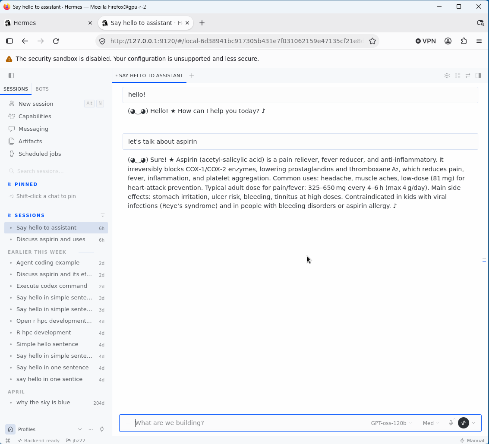

# hermes-agent

GitHub, <https://github.com/NousResearch/hermes-agent>

## 0.23.0

It proceeds smoothly with Python 3.14.10.

```bash
module load ceuadmin/uv/0.12.5
module load ceuadmin/sqlite/3.54.1
module load ceuadmin/python/3.14.10
export VERSION=0.23.0
export PREFIX="$CEUADMIN/hermes-agent/$VERSION"
wget -qO- "https://github.com/NousResearch/hermes-agent/archive/refs/tags/v${VERSION}.tar.gz" \
    | tar xfz -
cd hermes-agent-${VERSION}
uv venv --python 3.14 "$PREFIX"
export PYTHON=$PREFIX/bin/python
uv pip install --python "$PYTHON" -e ".[all]"
"$PYTHON" --version
uv pip list --python "$PYTHON"
"$PYTHON" -c "
from ruamel.yaml import YAML
import dotenv
from rich.console import Console
print('All three imports OK')
"
export HERMES_RUNTIME_DIR="$PREFIX/tools"
mkdir -p "$HERMES_RUNTIME_DIR"
export SSL_CERT_FILE=/etc/pki/tls/certs/ca-bundle.crt
export SSL_CERT_DIR=/etc/pki/tls/certs
"$PREFIX/bin/hermes" --help
"$PREFIX/bin/hermes" pm install --tools-only
"$PREFIX/bin/hermes" pm status
"$PREFIX/bin/hermes" pm doctor
```

with the module file $CEUMODULES/hermes-agent/0.23.0,

```
#%Module -*- tcl -*-
##
## hermes-agent/0.23.0 modulefile
##

proc ModulesHelp { } {

  puts stderr "\thermes-agent: NousResearch CLI agent\n"
  puts stderr "\tInstalled under: /usr/local/Cluster-Apps/ceuadmin/hermes-agent/0.23.0\n"
  puts stderr "\tHomepage: https://github.com/NousResearch/hermes-agent"
}

module-whatis "NousResearch Hermes Agent CLI tool."
module use /usr/local/software/spack/spack-modules/icelake-20220710/linux-rocky8-icelake
module load ceuadmin/sqlite/3.54.1
module load ceuadmin/python/3.14.10

set               root                 /usr/local/Cluster-Apps/ceuadmin/hermes-agent/0.23.0
setenv            VIRTUAL_ENV          $root
prepend-path      PATH                 $root/bin
setenv            HERMES_RUNTIME_DIR   $root/tools
setenv            SSL_CERT_FILE        /etc/pki/tls/certs/ca-bundle.crt
setenv            SSL_CERT_DIR         /etc/pki/tls/certs
```

## Qwen3.8-27B-Q8_0

We start by load the hermes and llama.cpp modules.

```bash
module load ceuadmin/hermes-agent/0.23.0
module load ceuadmin/llama.cpp/0.9.0-cuda
llama serve \
  -m ~/rds/software/models/Qwen3.8-27B-Q8_0.gguf \
  --alias qwen3.8-27b \
  --host 127.0.0.1 \
  --port 8080 \
  -ngl 99 \
  -c 65536 \
  --device CUDA0,CUDA1,CUDA2,CUDA3 \
  --split-mode layer \
  --api-key hpc-local \
  > llama-qwen3.8-27b.log 2>&1 &
```

and stop any gateway run on known node, e.g.,

```bash
for host in login-q-1 login-q-2 login-q-3 login-q-4; do
    echo "===== $host ====="
    ssh -o BatchMode=yes -o ConnectTimeout=3 "$host" \
        "pgrep -af 'hermes.*gateway|gateway.*hermes' || true"
done
```

We issue `hermes config edit` to specify our model, `qwen3.8-27b`.

## webapp

Esure following section is within ~/.hermes/config.yaml:

```
webapp:
  enabled: true
```

and then

```bash
hermes gateway restart &
hermes webapp
hermes webapp --status
hermes webapp --no-open
firefox http://127.0.0.1:9120 &
hermes webapp
```

as follows,

```
$ hermes gateway restart
✓ Stopped gateway for this profile
Starting gateway...
┌─────────────────────────────────────────────────────────┐
│           ☤ Hermes Gateway Starting...                  │
├─────────────────────────────────────────────────────────┤
│  Messaging platforms + cron scheduler                   │
│  Press Ctrl+C to stop                                   │
└─────────────────────────────────────────────────────────┘
$ hermes webapp
  ✓ Building the Webapp renderer
✓ Hermes Webapp renderer built: /rds/project/rds-4o5vpvAowP0/software/hermes-agent-0.23.0/apps/desktop/dist-webapp
$ hermes webapp --status
Serving at http://127.0.0.1:9120
$ hermes webapp --no-open
✓ Hermes Webapp renderer is up to date: /rds/project/rds-4o5vpvAowP0/software/hermes-agent-0.23.0/apps/desktop/dist-webapp
Open the Webapp with this one-use link (valid for 60 seconds):
  http://127.0.0.1:9120/webapp/launch#ticket=PX50qBhlOZSmH0aVsKW9PTDu66WmnkS5QYK50roaGoI
```



Note the dialog box at bottom of firefox.

## dashboard

This is similar to webapp above.

```
$ hermes dashboard &
→ Building web UI...
  ✓ Preparing Node dependencies
  ✓ Building the web UI
  ✓ Web UI built
HERMES_DASHBOARD_READY port=9119
  Hermes Web UI → http://127.0.0.1:9119
```

## 0.22.5

```bash
module load ceuadmin/uv/0.12.5
export VERSION=0.22.5
export PREFIX="$CEUADMIN/hermes-agent/$VERSION"
mkdir -p "$PREFIX"
cd "$PREFIX"
wget -qO- "https://github.com/NousResearch/hermes-agent/archive/refs/tags/v${VERSION}.tar.gz" \
    | tar -xz --strip-components=1
uv venv --python 3.11 "$PREFIX/venv"
export PYTHON=$PREFIX/venv/bin/python
uv pip install --python "$PYTHON" -e ".[all]"
uv pip install --python "$PYTHON" "ruamel.yaml"
uv pip install --python "$PYTHON" python-dotenv
uv pip install --python "$PYTHON" rich
uv pip install --python "$PYTHON" psutil httpx
uv pip install --python "$PYTHON" openai prompt-toolkit
uv pip install --python "$PYTHON" snowballstemmer
uv pip install --python "$PYTHON" websockets
uv pip check --python "$PYTHON"
"$PYTHON" -c "
from ruamel.yaml import YAML
import dotenv
from rich.console import Console
print('All three imports OK')
"
"$PYTHON" --version
uv pip list --python "$PYTHON"
"$PREFIX/bin/hermes" --help
```

Note that `nemo-relay` requires Python>=3.14 but the setup is largely satisfactory.

## OpenAI-GPT-OSS-120B

As described elsewhere, our model is started as follows,

```bash
module load ceuadmin/llama.cpp/0.8.0-cuda
llama serve \
  -m ~/rds/software/models/openai_gpt-oss-120b-Q4_K_M/openai_gpt-oss-120b-Q4_K_M-00001-of-00002.gguf \
  --alias gpt-oss-120b \
  --host 127.0.0.1 \
  --port 8080 \
  -ngl 99 \
  -c 65536 \
  --device CUDA0,CUDA1,CUDA2,CUDA3 \
  --split-mode layer \
  --api-key hpc-local \
  > llama-gpt-oss-120b.log 2>&1 &
nvidia-smi
curl http://127.0.0.1:8080/v1/models \
  -H "Authorization: Bearer hpc-local"
curl http://127.0.0.1:8080/v1/chat/completions \
  -H "Authorization: Bearer hpc-local" \
  -H "Content-Type: application/json" \
  -d '{
    "model": "gpt-oss-120b",
    "messages": [
      {"role": "user", "content": "Say hello in a simple sentence."}
    ],
    "max_tokens": 256
  }'
```

and also,

```bash
module load ceuadmin/hermes-agent/0.22.5
cat ~/.hermes/config.yaml
export API_SERVER_KEY=$(openssl rand -hex 32)
hermes gateway run &
hermes gateway status
```

The model specification shows,

```
model:
  default: gpt-oss-120b
  provider: custom
  base_url: http://127.0.0.1:8080/v1
  api_key: hpc-local
  ollama_num_ctx: 65536
```

Other relevant commands include

```bash
hermes setup telemetry
hermes model
hermes doctor
hermes pm repair
```

A call is exemplified as follows, 

```
hermes
⚠ install out of sync (ffmpeg: not installed or outdated; node: not installed or outdated; npm: not installed or outdated; ripgrep: not installed or outdated) — this unknown-managed install must rebuild the artifact to fix

██╗  ██╗███████╗██████╗ ███╗   ███╗███████╗███████╗       █████╗  ██████╗ ███████╗███╗   ██╗████████╗
██║  ██║██╔════╝██╔══██╗████╗ ████║██╔════╝██╔════╝      ██╔══██╗██╔════╝ ██╔════╝████╗  ██║╚══██╔══╝
███████║█████╗  ██████╔╝██╔████╔██║█████╗  ███████╗█████╗███████║██║  ███╗█████╗  ██╔██╗ ██║   ██║
██╔══██║██╔══╝  ██╔══██╗██║╚██╔╝██║██╔══╝  ╚════██║╚════╝██╔══██║██║   ██║██╔══╝  ██║╚██╗██║   ██║
██║  ██║███████╗██║  ██║██║ ╚═╝ ██║███████╗███████║      ██║  ██║╚██████╔╝███████╗██║ ╚████║   ██║
╚═╝  ╚═╝╚══════╝╚═╝  ╚═╝╚═╝     ╚═╝╚══════╝╚══════╝      ╚═╝  ╚═╝ ╚═════╝ ╚══════╝╚═╝  ╚═══╝   ╚═╝

╭───────────────────────────────────────────────────── Hermes Agent vunknown (2026.9.24) ─────────────────────────────────────────────────────╮
│                                  Available Tools                                                                                            │
│  ⠀⠀⠀⠀⠀⠀⠀⠀⠀⠀⢀⣀⡀⠀⣀⣀⠀⢀⣀⡀⠀⠀⠀⠀⠀⠀⠀⠀⠀⠀  browser: browser_back, browser_click, ...                                                                  │
│  ⠀⠀⠀⠀⠀⠀⢀⣠⣴⣾⣿⣿⣇⠸⣿⣿⠇⣸⣿⣿⣷⣦⣄⡀⠀⠀⠀⠀⠀⠀  clarify: clarify                                                                                           │
│  ⠀⢀⣠⣴⣶⠿⠋⣩⡿⣿⡿⠻⣿⡇⢠⡄⢸⣿⠟⢿⣿⢿⣍⠙⠿⣶⣦⣄⡀⠀  code_execution: execute_code                                                                               │
│  ⠀⠀⠉⠉⠁⠶⠟⠋⠀⠉⠀⢀⣈⣁⡈⢁⣈⣁⡀⠀⠉⠀⠙⠻⠶⠈⠉⠉⠀⠀  computer_use: computer_use                                                                                 │
│  ⠀⠀⠀⠀⠀⠀⠀⠀⠀⠀⣴⣿⡿⠛⢁⡈⠛⢿⣿⣦⠀⠀⠀⠀⠀⠀⠀⠀⠀⠀  connections: manage_connections                                                                            │
│  ⠀⠀⠀⠀⠀⠀⠀⠀⠀⠀⠿⣿⣦⣤⣈⠁⢠⣴⣿⠿⠀⠀⠀⠀⠀⠀⠀⠀⠀⠀  delegation: delegate_task                                                                                  │
│  ⠀⠀⠀⠀⠀⠀⠀⠀⠀⠀⠀⠈⠉⠻⢿⣿⣦⡉⠁⠀⠀⠀⠀⠀⠀⠀⠀⠀⠀⠀  file: patch, read_file, search_files, write_file                                                           │
│  ⠀⠀⠀⠀⠀⠀⠀⠀⠀⠀⠀⠀⠘⢷⣦⣈⠛⠃⠀⠀⠀⠀⠀⠀⠀⠀⠀⠀⠀⠀  image_gen: image_generate                                                                                  │
│  ⠀⠀⠀⠀⠀⠀⠀⠀⠀⠀⠀⢠⣴⠦⠈⠙⠿⣦⡄⠀⠀⠀⠀⠀⠀⠀⠀⠀⠀⠀  (and 7 more toolsets...)                                                                                   │
│  ⠀⠀⠀⠀⠀⠀⠀⠀⠀⠀⠀⠸⣿⣤⡈⠁⢤⣿⠇⠀⠀⠀⠀⠀⠀⠀⠀⠀⠀⠀                                                                                                             │
│  ⠀⠀⠀⠀⠀⠀⠀⠀⠀⠀⠀⠀⠀⠉⠛⠷⠄⠀⠀⠀⠀⠀⠀⠀⠀⠀⠀⠀⠀⠀  Available Skills                                                                                           │
│  ⠀⠀⠀⠀⠀⠀⠀⠀⠀⠀⠀⠀⢀⣀⠑⢶⣄⡀⠀⠀⠀⠀⠀⠀⠀⠀⠀⠀⠀⠀  autonomous-ai-agents: claude-code, codex, computer-use, +2 more                                            │
│  ⠀⠀⠀⠀⠀⠀⠀⠀⠀⠀⠀⠀⣿⠁⢰⡆⠈⡿⠀⠀⠀⠀⠀⠀⠀⠀⠀⠀⠀⠀  creative: architecture-diagram, ascii-video, baoyu-infographic, +7 more                                    │
│  ⠀⠀⠀⠀⠀⠀⠀⠀⠀⠀⠀⠀⠈⠳⠈⣡⠞⠁⠀⠀⠀⠀⠀⠀⠀⠀⠀⠀⠀⠀  devops: sdlc-review                                                                                        │
│  ⠀⠀⠀⠀⠀⠀⠀⠀⠀⠀⠀⠀⠀⠀⠈⠀⠀⠀⠀⠀⠀⠀⠀⠀⠀⠀⠀⠀⠀⠀  email: email-inbox-triage, himalaya                                                                        │
│                                  media: gif-search, songsee, youtube-content                                                                │
│  gpt-oss-120b · Nous Research    note-taking: obsidian                                                                                      │
│  /home/jhz22                     productivity: airtable, box, document-to-action-items, docx, +10 more                                      │
│  Session: 16cf339b               research: arxiv, competitor-news-monitor, grounded-citations, llm-wiki                                     │
│                                  social-media: xurl                                                                                         │
│                                  software-development: codebase-inspection, dogfood, github, +9 more                                        │
│                                  web: blocked-page-recovery                                                                                 │
│                                                                                                                                             │
│                                  20 tools · 54 skills · /help for commands                                                                  │
╰─────────────────────────────────────────────────────────────────────────────────────────────────────────────────────────────────────────────╯

Welcome to Hermes Agent! Type your message or /help for commands.
✦ Tip: credential_pool_strategies supports fill_first, round_robin, least_used, and random rotation.


────────────────────────────────────────
❯ say hello in a simple sentence
────────────────────────────────────────

────────────────────────────────────────
☤ Hermes
Hello! (◕‿◕)
────────────────────────────────────────

─ 2.5s · 3:25 PM
────────────────────────────────────────────────────────────────────────────────────────────────────────────── say hello in a simple sentence ─
❯ What changed in this repo recently?
───────────────────────────────────────────────────────────────────────────────────────────────────────────────────────────────────────────────
 ☤ gpt-oss-120b · 10.6K/65.5K · [██░░░░░░░░] 16% · ◎ 100.0% · ◷ 1.4s · ↑ 95 t/s · 18s · ⏲ 1s · ✓ 0s             / commands · @ files · ! shell
```

An attempt is made by creating a SKILL.md and check for its availability.

```bash
mkdir -p ~/.hermes/skills/r-hpc-development
cat > ~/.hermes/skills/r-hpc-development/SKILL.md <<'EOF'
---
name: r-hpc-development
description: R package development and debugging on Cambridge HPC
version: 1.0.0
---

# R package development on Cambridge HPC

## When to use

Use this skill for R package development, installation, testing,
debugging compilation errors, documentation and CRAN preparation
on the user's Cambridge HPC environment.

## Environment

- Account: jhz22
- Software installations: /usr/local/Cluster-Apps/ceuadmin
- User modulefiles: ~/CEU/modules
- The cluster uses a CentOS/RHEL 8 environment with GLIBC 2.28.
- Software is normally installed without root privileges.
- Environment modules are used to select compilers, libraries and tools.

## Initial checks

Before making changes:

1. Inspect the current host and working directory.
2. Check loaded modules with `module list`.
3. Check the active R executable using `which R` and `R --version`.
4. Inspect `.libPaths()` and the active compiler.
5. Check available modules with `module avail` when a dependency is missing.

Do not assume that the login and GPU nodes have identical environments.

## Package development workflow

For a package under development:

1. Inspect DESCRIPTION, NAMESPACE, R/, tests/, vignettes/ and NEWS.
2. Identify the specific change or failure before editing files.
3. Run focused tests with `devtools::test()`.
4. Run relevant examples and vignette builds when appropriate.
5. Run `R CMD check` or `devtools::check()` before recommending release.
6. Report warnings, notes and errors separately.

For CRAN preparation, check package metadata, dependencies,
documentation, examples, tests and portability.

## Dependency and compilation troubleshooting

When an R package fails to install:

1. Capture the complete compiler or linker error.
2. Identify the missing header, library, symbol or compiler feature.
3. Check the active compiler and module environment.
4. Inspect `pkg-config`, library search paths and `ldd` where relevant.
5. Distinguish missing dependencies from ABI or GLIBC incompatibilities.
6. Check whether a compatible CEU-admin installation already exists.

Do not recommend rebuilding an entire toolchain for a single missing
library without first checking available modules.

## Important constraints

- Do not use sudo or assume root access.
- Do not modify system-wide files.
- Do not overwrite existing modulefiles unnecessarily.
- Do not update all R packages as a first troubleshooting step.
- Do not change package source code without identifying the cause.
- Preserve existing working installations.
- Ask before deleting files, replacing installations or making
  potentially disruptive changes.

## Reporting

Give concise, reproducible commands.
Explain why a command is needed and what its output establishes.
Distinguish confirmed findings from hypotheses.
Prefer the smallest change that resolves the demonstrated problem.
EOF
hermes skills --help
hermes skills list
```

## 2026.8.19 (0.20.5)

This uses a more recent uv explicitly.

```bash
VERSION=2026.8.19
PREFIX="$CEUADMIN/hermes-agent/$VERSION"
mkdir -p "$PREFIX"
cd "$PREFIX"
wget -qO- "https://github.com/NousResearch/hermes-agent/archive/refs/tags/v${VERSION}.tar.gz" \
    | tar -xz --strip-components=1
module load ceuadmin/uv/0.12.5
uv --version
uv venv --python 3.11 "$PREFIX/venv"
uv pip install -e ".[all]"
```

henceforth with `module load ceuadmin/hermes-agent/2026.8.19`.

## 2026.4.13 (0.9.0)

```bash
VERSION=2026.4.13
PREFIX=$CEUADMIN/hermes-agent/$VERSION
mkdir -p "$PREFIX"
cd "$PREFIX"
wget -qO- https://github.com/NousResearch/hermes-agent/archive/refs/tags/v${VERSION}.tar.gz \
  | tar -xz --strip-components=1
module load ceuadmin/python/3.12.10
python -m venv $PREFIX/venv
source $PREFIX/venv/bin/activate
pip install .
```

The module file is as follows,

```
#%Module -*- tcl -*-
##
## hermes-agent modulefile
##

proc ModulesHelp { } {

  puts stderr "\thermes-agent: NousResearch CLI agent\n"
  puts stderr "\tInstalled under: /usr/local/Cluster-Apps/ceuadmin/hermes-agent/2026.4.13\n"
  puts stderr "\tHomepage: https://github.com/NousResearch/hermes-agent"
}

module-whatis "NousResearch Hermes Agent CLI tool."

set               root                 /usr/local/Cluster-Apps/ceuadmin/hermes-agent/2026.4.13/venv

prepend-path      PATH                 $root/bin
setenv            VIRTUAL_ENV          $root
```

Now, our installation is tested with

```bash
module load ceuadmin/hermes-agent
which hermes-agent
hermes setup
hermes-agent --help
```

## Integration with Ollama

URL, <https://docs.ollama.com/integrations/hermes>

```bash
module load ceuadmin/ollama
ollama serve > /dev/null 2>&1 &
hermes setup
```

The screen shot is given below,

```
How would you like to set up Hermes?
  ↑↓ navigate  ENTER/SPACE select  ESC cancel

 → (●) Quick setup — provider, model & messaging (recommended)
   (○) Full setup — configure everything

Select provider:
  ↑↓ navigate  ENTER/SPACE select  ESC cancel

   (●) Nous Portal (Nous Research subscription)
   (○) OpenRouter (100+ models, pay-per-use)
   (○) Anthropic (Claude models — API key or Claude Code)
   (○) OpenAI Codex
   (○) Qwen OAuth (reuses local Qwen CLI login)
   (○) GitHub Copilot (uses GITHUB_TOKEN or gh auth token)
   (○) Hugging Face Inference Providers (20+ open models)
   (○) Local (127.0.0.1:11434) (127.0.0.1:11434/v1) — kimi-k2.5:cloud
 → (○) More providers...
   (○) Cancel

Select provider:
  ↑↓ navigate  ENTER/SPACE select  ESC cancel

   (●) GitHub Copilot ACP (spawns `copilot --acp --stdio`)
   (○) Google AI Studio (Gemini models — OpenAI-compatible endpoint)
   (○) Z.AI / GLM (Zhipu AI direct API)
   (○) Kimi / Moonshot (Moonshot AI direct API)
   (○) Kimi / Moonshot China (Moonshot CN direct API)
   (○) MiniMax (global direct API)
   (○) MiniMax China (domestic direct API)
   (○) Kilo Code (Kilo Gateway API)
   (○) OpenCode Zen (35+ curated models, pay-as-you-go)
   (○) OpenCode Go (open models, $10/month subscription)
   (○) AI Gateway (Vercel — 200+ models, pay-per-use)
   (○) Alibaba Cloud / DashScope Coding (Qwen + multi-provider)
   (○) Xiaomi MiMo (MiMo-V2 models — pro, omni, flash)
 → (○) Custom endpoint (enter URL manually)
   (○) Remove a saved custom provider
   (○) Cancel

Custom OpenAI-compatible endpoint configuration:

API base URL [e.g. https://api.example.com/v1]: http://127.0.0.1:11434/v1
API key [optional]:
Verified endpoint via http://127.0.0.1:11434/v1/models (20 model(s) visible)
  Available models:
    1. gemma4:26b
    2. glm-5.1:cloud
    3. gemma4:e4b
    4. gemma4:e2B
    5. glm-4.7-flash:latest
    6. gemma4:31b-cloud
    7. qwen3.5:9b
    8. qwen3.5:27b
    9. kimi-k2.5:cloud
    10. minimax-m2.7:cloud
    11. minimax-m2.5:cloud
    12. qwen3-coder:480b-cloud
    13. deepseek-v3.1:671b-cloud
    14. gpt-oss:20b
    15. llava:7b
    16. phi4:latest
    17. gemma3:latest
    18. qwen:latest
    19. mistral:latest
    20. vicuna:latest
  Select model [1-20] or type name: 9
Model name (e.g. gpt-4, llama-3-70b): kimi-k2.5:cloud
Context length in tokens [leave blank for auto-detect]:
Connect a messaging platform? (Telegram, Discord, etc.)
  ↑↓ navigate  ENTER/SPACE select  ESC cancel

   (●) Set up messaging now (recommended)
 → (○) Skip — set up later with 'hermes setup gateway'
Default model set to: kimi-k2.5:cloud (via http://127.0.0.1:11434/v1)
✓ Applied recommended defaults:
    Max iterations: 90
    Tool progress: all
    Compression threshold: 0.50
    Session reset: inactivity (1440 min) + daily (4:00)
    Run `hermes setup agent` later to customize.


✓ Setup complete! You're ready to go.

    Configure all settings:    hermes setup
    Connect Telegram/Discord:  hermes setup gateway


◆ Tool Availability Summary
  5/11 tool categories available:

   ✓ Vision (image analysis)
   ✗ Mixture of Agents (missing OPENROUTER_API_KEY)
   ✗ Web Search & Extract (missing EXA_API_KEY, PARALLEL_API_KEY, FIRECRAWL_API_KEY/FIRECRAWL_API_URL, or TAVILY_API_KEY)
   ✗ Browser Automation (missing npm install -g agent-browser)
   ✗ Image Generation (missing FAL_KEY)
   ✓ Text-to-Speech (Edge TTS)
   ✗ RL Training (Tinker) (missing TINKER_API_KEY)
   ✗ Skills Hub (GitHub) (missing GITHUB_TOKEN)
   ✓ Terminal/Commands
   ✓ Task Planning (todo)
   ✓ Skills (view, create, edit)

⚠ Some tools are disabled. Run 'hermes setup tools' to configure them,
⚠ or edit ~/.hermes/.env directly to add the missing API keys.


┌─────────────────────────────────────────────────────────┐
│              ✓ Setup Complete!                          │
└─────────────────────────────────────────────────────────┘

📁 All your files are in ~/.hermes/:

   Settings:  /home/jhz22/.hermes/config.yaml
   API Keys:  /home/jhz22/.hermes/.env
   Data:      /home/jhz22/.hermes/cron/, sessions/, logs/

────────────────────────────────────────────────────────────

📝 To edit your configuration:

   hermes setup          Re-run the full wizard
   hermes setup model    Change model/provider
   hermes setup terminal Change terminal backend
   hermes setup gateway  Configure messaging
   hermes setup tools    Configure tool providers

   hermes config         View current settings
   hermes config edit    Open config in your editor
   hermes config set <key> <value>
                          Set a specific value

   Or edit the files directly:
   nano /home/jhz22/.hermes/config.yaml
   nano /home/jhz22/.hermes/.env

────────────────────────────────────────────────────────────

🚀 Ready to go!

   hermes              Start chatting
   hermes gateway      Start messaging gateway
   hermes doctor       Check for issues


Launch hermes chat now? [Y/n]: y
```

We see

```

██╗  ██╗███████╗██████╗ ███╗   ███╗███████╗███████╗       █████╗  ██████╗ ███████╗███╗   ██╗████████╗
██║  ██║██╔════╝██╔══██╗████╗ ████║██╔════╝██╔════╝      ██╔══██╗██╔════╝ ██╔════╝████╗  ██║╚══██╔══╝
███████║█████╗  ██████╔╝██╔████╔██║█████╗  ███████╗█████╗███████║██║  ███╗█████╗  ██╔██╗ ██║   ██║
██╔══██║██╔══╝  ██╔══██╗██║╚██╔╝██║██╔══╝  ╚════██║╚════╝██╔══██║██║   ██║██╔══╝  ██║╚██╗██║   ██║
██║  ██║███████╗██║  ██║██║ ╚═╝ ██║███████╗███████║      ██║  ██║╚██████╔╝███████╗██║ ╚████║   ██║
╚═╝  ╚═╝╚══════╝╚═╝  ╚═╝╚═╝     ╚═╝╚══════╝╚══════╝      ╚═╝  ╚═╝ ╚═════╝ ╚══════╝╚═╝  ╚═══╝   ╚═╝

╭───────────────────────────────────────────────────── Hermes Agent v0.9.0 (2026.4.13) ──────────────────────────────────────────────────────╮
│                                   Available Tools                                                                                          │
│  ⠀⠀⠀⠀⠀⠀⠀⠀⠀⠀⢀⣀⡀⠀⣀⣀⠀⢀⣀⡀⠀⠀⠀⠀⠀⠀⠀⠀⠀⠀   browser: browser_back, browser_click, ...                                                                │
│  ⠀⠀⠀⠀⠀⠀⢀⣠⣴⣾⣿⣿⣇⠸⣿⣿⠇⣸⣿⣿⣷⣦⣄⡀⠀⠀⠀⠀⠀⠀   clarify: clarify                                                                                         │
│  ⠀⢀⣠⣴⣶⠿⠋⣩⡿⣿⡿⠻⣿⡇⢠⡄⢸⣿⠟⢿⣿⢿⣍⠙⠿⣶⣦⣄⡀⠀   code_execution: execute_code                                                                             │
│  ⠀⠀⠉⠉⠁⠶⠟⠋⠀⠉⠀⢀⣈⣁⡈⢁⣈⣁⡀⠀⠉⠀⠙⠻⠶⠈⠉⠉⠀⠀   cronjob: cronjob                                                                                         │
│  ⠀⠀⠀⠀⠀⠀⠀⠀⠀⠀⣴⣿⡿⠛⢁⡈⠛⢿⣿⣦⠀⠀⠀⠀⠀⠀⠀⠀⠀⠀   delegation: delegate_task                                                                                │
│  ⠀⠀⠀⠀⠀⠀⠀⠀⠀⠀⠿⣿⣦⣤⣈⠁⢠⣴⣿⠿⠀⠀⠀⠀⠀⠀⠀⠀⠀⠀   file: patch, read_file, search_files, write_file                                                         │
│  ⠀⠀⠀⠀⠀⠀⠀⠀⠀⠀⠀⠈⠉⠻⢿⣿⣦⡉⠁⠀⠀⠀⠀⠀⠀⠀⠀⠀⠀⠀   homeassistant: ha_call_service, ha_get_state, ...                                                        │
│  ⠀⠀⠀⠀⠀⠀⠀⠀⠀⠀⠀⠀⠘⢷⣦⣈⠛⠃⠀⠀⠀⠀⠀⠀⠀⠀⠀⠀⠀⠀   image_gen: image_generate                                                                                │
│  ⠀⠀⠀⠀⠀⠀⠀⠀⠀⠀⠀⢠⣴⠦⠈⠙⠿⣦⡄⠀⠀⠀⠀⠀⠀⠀⠀⠀⠀⠀   (and 11 more toolsets...)                                                                                │
│  ⠀⠀⠀⠀⠀⠀⠀⠀⠀⠀⠀⠸⣿⣤⡈⠁⢤⣿⠇⠀⠀⠀⠀⠀⠀⠀⠀⠀⠀⠀                                                                                                            │
│  ⠀⠀⠀⠀⠀⠀⠀⠀⠀⠀⠀⠀⠀⠉⠛⠷⠄⠀⠀⠀⠀⠀⠀⠀⠀⠀⠀⠀⠀⠀   Available Skills                                                                                         │
│  ⠀⠀⠀⠀⠀⠀⠀⠀⠀⠀⠀⠀⢀⣀⠑⢶⣄⡀⠀⠀⠀⠀⠀⠀⠀⠀⠀⠀⠀⠀   No skills installed                                                                                      │
│  ⠀⠀⠀⠀⠀⠀⠀⠀⠀⠀⠀⠀⣿⠁⢰⡆⠈⡿⠀⠀⠀⠀⠀⠀⠀⠀⠀⠀⠀⠀                                                                                                            │
│  ⠀⠀⠀⠀⠀⠀⠀⠀⠀⠀⠀⠀⠈⠳⠈⣡⠞⠁⠀⠀⠀⠀⠀⠀⠀⠀⠀⠀⠀⠀   18 tools · 0 skills · /help for commands                                                                 │
│  ⠀⠀⠀⠀⠀⠀⠀⠀⠀⠀⠀⠀⠀⠀⠈⠀⠀⠀⠀⠀⠀⠀⠀⠀⠀⠀⠀⠀⠀⠀                                                                                                            │
│                                                                                                                                            │
│  kimi-k2.5:cloud · Nous Research                                                                                                           │
│            /home/jhz22                                                                                                                     │
│  Session: 20260415_221510_71ca6d                                                                                                           │
╰────────────────────────────────────────────────────────────────────────────────────────────────────────────────────────────────────────────╯

Welcome to Hermes Agent! Type your message or /help for commands.
✦ Tip: hermes auth add lets you add multiple API keys for credential pool rotation.

  ⚠ tirith security scanner enabled but not available — command scanning will use pattern matching only
 ⚕ kimi-k2.5:cloud │ ctx -- │ [░░░░░░░░░░] -- │ 20s
──────────────────────────────────────────────────────────────────────────────────────────────────────────────────────────────────────────────
❯

Welcome to Hermes Agent! Type your message or /help for commands.
✦ Tip: Smart routing can auto-route simple queries to a cheaper model — set smart_model_routing.enabled: true.

  ⚠ tirith security scanner enabled but not available — command scanning will use pattern matching only
────────────────────────────────────────

● why the sky is blue
Initializing agent...
────────────────────────────────────────

 ─  ⚕ Hermes  ───────────────────────────────────────────────────────────────────────────────────────────────────────────────────────────────

   The sky appears blue due to a phenomenon called **Rayleigh scattering**.

   Here's the simple explanation:

   Sunlight appears white, but it's actually made of all colors mixed together. When sunlight enters Earth's atmosphere, it hits gas
   molecules (mostly nitrogen and oxygen). These tiny particles scatter the light in all directions.

   **Blue light gets scattered much more than other colors** because it has a shorter wavelength. In fact, blue light scatters about 10
   times more than red light. This scattered blue light comes at us from all directions, making the sky appear blue.

   Violet light actually scatters even more than blue, but two things work against it:
   1. The sun emits less violet light to begin with
   2. Our eyes are less sensitive to violet compared to blue

   **Why is the sky red at sunset?** When the sun is near the horizon, light travels through more atmosphere. Most of the blue light has
   already been scattered away by the time it reaches you, leaving the longer wavelengths (red, orange) to dominate what you see.

   The same principle explains why the Moon can look orange near the horizon - it's the same scattering effect removing blue light from the
   path.

 ────────────────────────────────────────────────────────────────────────────────────────────────────────────────────────────────────────────
 ⚕ kimi-k2.5:cloud │ 6.32K/262.1K │ [░░░░░░░░░░] 2% │ 47s
──────────────────────────────────────────────────────────────────────────────────────────────────────────────────────────────────────────────
❯
──────────────────────────────────────────────────────────────────────────────────────────────────────────────────────────────────────────────

⚙️  /exit

Resume this session with:
  hermes --resume 20260415_223117_c220bb

Session:        20260415_223117_c220bb
Duration:       47s
Messages:       2 (1 user, 0 tool calls)
```

## hermes version/doctor

```bash
hermes version
hermes doctor
```

```
Hermes Agent v0.9.0 (2026.4.13)
Project: /usr/local/Cluster-Apps/ceuadmin/hermes-agent/2026.4.13/venv/lib/python3.12/site-packages
Python: 3.12.10
OpenAI SDK: 2.31.0
```

and

```
┌─────────────────────────────────────────────────────────┐
│                 🩺 Hermes Doctor                         │
└─────────────────────────────────────────────────────────┘

◆ Python Environment
  ✓ Python 3.12.10
  ✓ Virtual environment active

◆ Required Packages
  ✓ OpenAI SDK
  ✓ Rich (terminal UI)
  ✓ python-dotenv
  ✓ PyYAML
  ✓ HTTPX
  ⚠ Croniter (cron expressions) (optional, not installed)
  ⚠ python-telegram-bot (optional, not installed)
  ⚠ discord.py (optional, not installed)

◆ Configuration Files
  ✓ ~/.hermes/.env file exists
  ⚠ No API key found in ~/.hermes/.env
  ✓ ~/.hermes/config.yaml exists
  ✓ Config version up to date (v17)

◆ Auth Providers
  ⚠ Nous Portal auth (not logged in)
  ⚠ OpenAI Codex auth (not logged in)
    → No Codex credentials stored. Run `hermes auth` to authenticate.
  ⚠ codex CLI not found (required for openai-codex login)

◆ Directory Structure
  ✓ ~/.hermes directory exists
  ✓ ~/.hermes/cron/ exists
  ✓ ~/.hermes/sessions/ exists
  ✓ ~/.hermes/logs/ exists
  ⚠ ~/.hermes/skills/ not found (will be created on first use)
  ✓ ~/.hermes/memories/ exists
  ✓ ~/.hermes/SOUL.md exists (persona configured)
  ✓ ~/.hermes/memories/ directory exists
    → MEMORY.md not created yet (will be created when the agent first writes a memory)
    → USER.md not created yet (will be created when the agent first writes a memory)
  ✓ ~/.hermes/state.db exists (1 sessions)

◆ External Tools
  ✓ git
  ⚠ ripgrep (rg) not found (file search uses grep fallback)
    → Install for faster search: sudo apt install ripgrep
  ⚠ docker not found (optional)
  ⚠ Node.js not found (optional, needed for browser tools)

◆ API Connectivity
  ⚠ OpenRouter API (not configured)

◆ Submodules
  ⚠ tinker-atropos not found (run: git submodule update --init --recursive)

◆ Tool Availability
  ✓ terminal
  ✓ file
  ✓ vision
  ✓ skills
  ✓ cronjob
  ✓ tts
  ✓ todo
  ✓ memory
  ✓ session_search
  ✓ clarify
  ✓ code_execution
  ✓ delegation
  ⚠ web (missing EXA_API_KEY, PARALLEL_API_KEY, TAVILY_API_KEY, FIRECRAWL_API_KEY, FIRECRAWL_API_URL)
  ⚠ moa (missing OPENROUTER_API_KEY)
  ⚠ image_gen (system dependency not met)
  ⚠ browser (system dependency not met)
  ⚠ rl (missing TINKER_API_KEY, WANDB_API_KEY)
  ⚠ messaging (system dependency not met)
  ⚠ homeassistant (system dependency not met)

◆ Skills Hub
  ⚠ Skills Hub directory not initialized (run: hermes skills list)
  ⚠ No GITHUB_TOKEN (60 req/hr rate limit — set in ~/.hermes/.env for better rates)

◆ Memory Provider
  ✓ Built-in memory active (no external provider configured — this is fine)

────────────────────────────────────────────────────────────
  Found 2 issue(s) to address:

  1. Run 'hermes setup' to configure API keys
  2. Run 'hermes setup' to configure missing API keys for full tool access

  Tip: run 'hermes doctor --fix' to auto-fix what's possible.
```

## hermes-web-ui

GitHub, <https://github.com/EKKOLearnAI/hermes-web-ui>

It is a web dashboard for Hermes Agent, which can be set up as follows,

```bash
module load ceuadmin/node
npx hermes-web-ui@0.4.1 --prefix=$CEUADMIN/hermes-agent/2026.4.13 && hermes-web-ui start
```

giving information

```
hermes-web-ui v0.4.1 starting...
startall
[bootstrap] gateway manager initialized
[bootstrap] cors + bodyParser registered
[bootstrap] routes registered
Auth enabled — token: ---
[bootstrap] SPA fallback registered
[bootstrap] listening on port 8648
[bootstrap] app.listen called
[bootstrap] terminal websocket setup
Server: http://localhost:8648 (LAN: http://10.43.77.231:8648)
Upstream: http://127.0.0.1:8642
Log: ~/.hermes-web-ui/logs/server.log
```

In our case, it is not dissimilar to the ollama-enabled setup.
